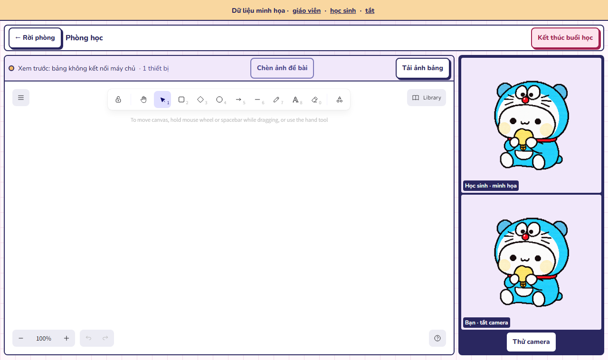
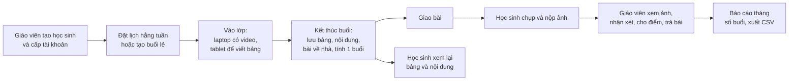
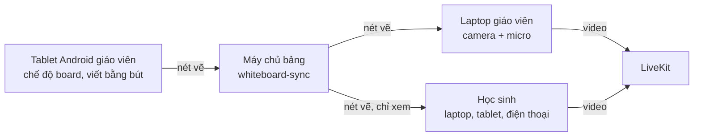
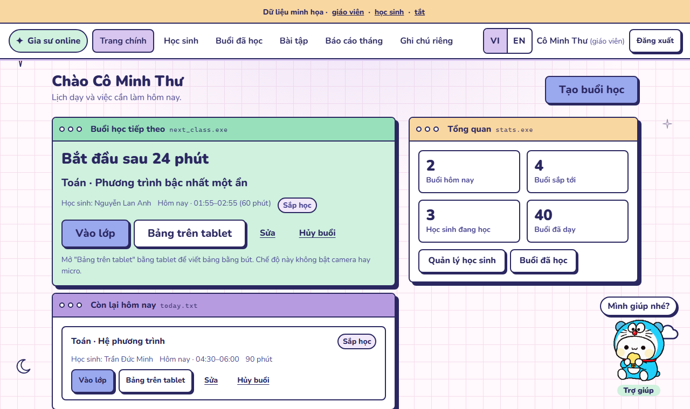
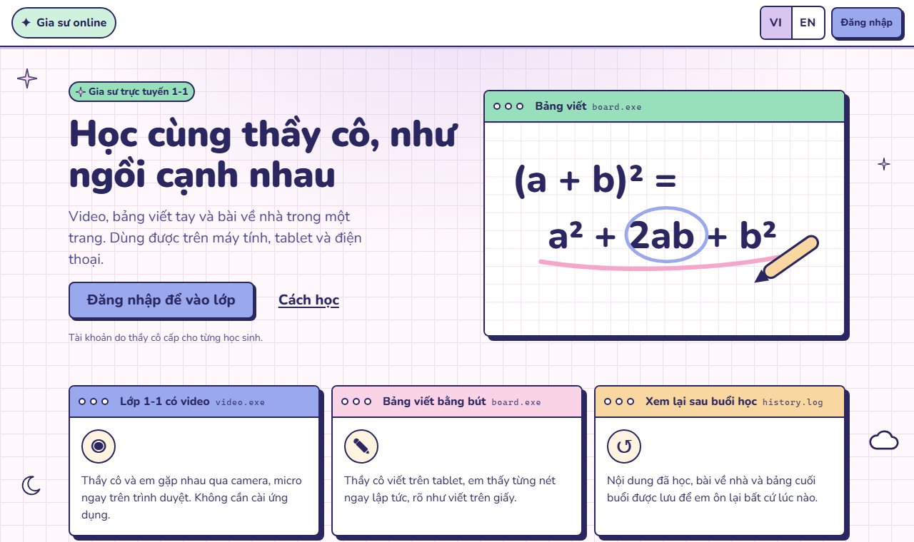
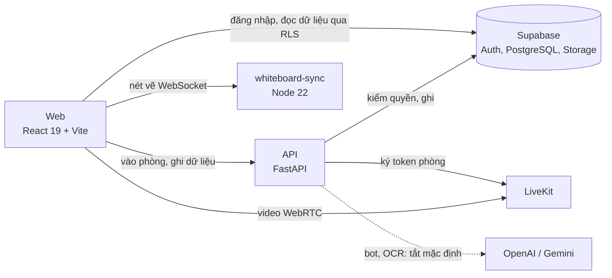

# Gia sư Online 1-1

[](https://github.com/TrungTuyenDo02/Web_teaching_online/actions/workflows/ci.yml)

Website dạy kèm trực tuyến 1-1 cho **một giáo viên và nhiều học sinh**. Website gom video, bảng viết tay bằng bút trên tablet, lịch học, bài về nhà và báo cáo vào một chỗ. Học sinh có thể là trẻ vị thành niên nên quyền riêng tư được đặt lên hàng đầu.



> **Trạng thái (2026-10-22):** đang phát triển, **chưa dùng để dạy thật**. Giai đoạn 1 đã có đủ chức năng chính và test tự động, nhưng chưa nghiệm thu với Supabase, LiveKit thật và tablet thật. Xem [Trạng thái và lộ trình](#trạng-thái-và-lộ-trình).

## Mục lục

- [Vấn đề cần giải quyết](#vấn-đề-cần-giải-quyết)
- [Cách dự án giải quyết](#cách-dự-án-giải-quyết)
- [Quy trình sử dụng](#quy-trình-sử-dụng)
- [Chức năng](#chức-năng)
- [Kiến trúc](#kiến-trúc)
- [Chạy thử](#chạy-thử)
- [Kiểm tra](#kiểm-tra)
- [Bảo mật và quyền riêng tư](#bảo-mật-và-quyền-riêng-tư)
- [Trạng thái và lộ trình](#trạng-thái-và-lộ-trình)
- [Tài liệu](#tài-liệu)

## Vấn đề cần giải quyết

Gia sư dạy 1-1 online, nhất là môn Toán, thường gặp những vấn đề sau:

| # | Vấn đề | Hệ quả |
|---|---|---|
| 1 | **Chia sẻ màn hình tablet để viết bảng.** Trình duyệt di động không hỗ trợ ổn định; video bị nén (các app gọi phổ biến thường chỉ 720p 30 FPS) | Chữ viết tay và công thức bị mờ, giật; học sinh khó đọc |
| 2 | **Hai thiết bị cùng vào cuộc gọi** (laptop để có camera, tablet để viết) | Tiếng vọng, tốn thêm phút video, thao tác rối |
| 3 | **Công cụ rời rạc:** một app gọi video, một app bảng, lịch và bài tập gửi qua tin nhắn, số buổi ghi tay | Học sinh lạc link; cuối tháng khó đếm đúng số buổi để tính học phí; bài làm thất lạc |
| 4 | **Bảng viết mất sau buổi học** | Học sinh không có gì để ôn lại |
| 5 | **Dữ liệu của trẻ vị thành niên** (ảnh bài làm, hồ sơ, ghi chú) nằm rải rác trong app chat | Khó kiểm soát ai xem được; khó xóa sạch khi phụ huynh yêu cầu |
| 6 | **Chi phí và vận hành** khi chỉ có một người | Không kham nổi hệ thống phức tạp hay phí theo đầu người cao |

## Cách dự án giải quyết

| # | Cách làm |
|---|---|
| 1 | **Bảng viết đồng bộ dạng dữ liệu, không phải video.** Giáo viên viết bằng bút trên tablet Android ([Excalidraw](https://github.com/excalidraw/excalidraw)); nét vẽ gửi đi dưới dạng dữ liệu nên luôn sắc nét và tốn ít băng thông |
| 2 | **Tablet ở chế độ `board` chỉ vào bảng**, không bật camera hay micro: không vọng tiếng, không tính phút video. Laptop giữ camera và micro |
| 3 | **Mọi thứ trong một website:** vào lớp, bảng, lịch hằng tuần tự sinh buổi, giao và nộp bài, báo cáo số buổi theo tháng (xuất CSV). Chỉ giáo viên bấm "Kết thúc" mới được tính là một buổi đã dạy |
| 4 | **Lưu bảng cuối buổi** cùng nội dung đã dạy và bài về nhà; học sinh xem lại ở mục "Buổi đã học" |
| 5 | **Quyền đặt ở cơ sở dữ liệu (RLS)** và API; học sinh chỉ thấy dữ liệu của mình. Có ghi nhận phụ huynh đồng ý, gỡ vị trí chụp khỏi ảnh, không ghi hình, xóa hẳn học sinh theo từng bước làm tiếp được |
| 6 | **Dùng dịch vụ có sẵn** (Supabase, LiveKit) cùng một API nhỏ và một máy chủ bảng nhỏ; LiveKit có thể tự dựng nếu cần giảm chi phí |

Lý do chi tiết của từng lựa chọn: [docs/decisions.md](docs/decisions.md).

## Quy trình sử dụng

### Một vòng dạy học



### Trong phòng học



- **Giáo viên:** trên laptop bấm **Vào lớp** để bật video; trên tablet bấm **Bảng trên tablet** để viết.
- **Học sinh:** bấm **Vào lớp**, thấy giáo viên, thấy mình và xem bảng (chỉ xem). Ô video nào chưa có hình sẽ hiện linh vật.
- **Kết thúc:** giáo viên bấm **Kết thúc buổi học**. Mọi thiết bị rời phòng, bảng được lưu và buổi học được tính.

Sơ đồ đầy đủ (đăng nhập, vào phòng, kết thúc, đồng bộ bảng, xóa học sinh, mô hình dữ liệu): [docs/flows.md](docs/flows.md).

## Chức năng

| Trang chính của giáo viên | Trang giới thiệu |
|---|---|
|  |  |

*Ảnh chụp ở chế độ xem trước, dữ liệu minh họa.*

**Giáo viên**

| Nhóm | Chức năng | Trạng thái |
|---|---|---|
| Phòng học | Video LiveKit; bảng viết đồng bộ, tự nối lại và gửi bù khi mất mạng; tải ảnh bảng; kết thúc buổi | Có, chưa thử dịch vụ thật |
| Học sinh | Tạo tài khoản, sửa, ngừng dạy, xóa hẳn (dọn Auth, Storage, bảng) | Có |
| Lịch | Buổi lẻ; lịch hằng tuần tự sinh buổi 28 ngày tới, chống trùng ở DB; tự đánh vắng mặt | Có |
| Sau buổi | Nội dung đã dạy, bài về nhà, xem lại bảng; ghi chú riêng và chủ đề đã dạy (xuất Markdown/CSV) | Có |
| Báo cáo | Số buổi theo tháng theo giờ Việt Nam, xuất CSV | Có |
| Bài tập | Giao bài, xem ảnh bài nộp, nhận xét và cho điểm 0–10, trả bài | Có code, cần áp migration 0011 |
| Trợ giúp | Linh vật hướng dẫn theo vai trò; bot OpenAI trả lời từ bài giảng và lịch/lớp (chỉ đọc, tên học sinh được mã hóa trước khi gửi) | Có, **tắt mặc định** |
| Đọc ảnh bằng AI | Gemini chép chữ và công thức từ ảnh bài làm để giáo viên chấm nhanh hơn | Có code, **tạm hoãn**; hiện chấm tay |

**Học sinh:** xem lịch, vào lớp, xem bảng, nộp ảnh bài làm (vị trí chụp và thông tin máy ảnh được gỡ), xem điểm, nhận xét và lại các buổi đã học.

**Chung:** tiếng Việt và tiếng Anh; dùng được trên điện thoại và tablet (vùng chạm ≥ 44 px); hướng theo chuẩn truy cập WCAG 2.1 AA (viền focus rõ, tiêu đề tab theo trang, trình đọc màn hình đọc được lỗi).

**Chưa có:** AI gợi ý chấm, Tutor cho học sinh, nhắc lịch qua email. Không ghi hình buổi học.

## Kiến trúc



| Thành phần | Công nghệ | Việc làm |
|---|---|---|
| `apps/web` | React 19, TypeScript, Vite, Excalidraw, LiveKit components | Giao diện giáo viên, học sinh, phòng học |
| `apps/api` | Python 3.13, FastAPI | Xác thực, phân quyền, buổi học, học sinh, lịch, bài tập, báo cáo; cấp token video và bảng; gọi AI |
| `services/whiteboard-sync` | Node 22, ws, jose | Đồng bộ nét vẽ theo buổi học, lưu bảng |
| `supabase/` | PostgreSQL, RLS | Schema theo migration đánh số, kiểm thử RLS, rollback |
| `evals/` | Python | Eval xác định (E0: thời gian nghiệp vụ) |

Nguyên tắc:
- Trình duyệt không bao giờ được tin; mọi thao tác ghi đi qua API.
- Vai trò lấy từ bảng `profiles`.
- API trả 404 cho tài nguyên không thuộc về người gọi.

Chi tiết: [docs/architecture.md](docs/architecture.md).

<details>
<summary>Cấu trúc thư mục</summary>

```
apps/
  api/                FastAPI: app/routers, app/services, app/repo.py (mọi truy vấn), tests/
  web/                React: src/pages, src/components, src/ui, src/lib; e2e/ (Playwright)
services/
  whiteboard-sync/    Máy chủ đồng bộ bảng: src/, test/
supabase/
  migrations/         Schema, RLS, bucket (0001 → 0011)
  rollback/           Gỡ thủ công các migration mới khi dữ liệu tương ứng trống
  tests/              run.sh: kiểm thử migration, RLS, giao dịch hai kết nối
  verify_migrations.sql  Kiểm tra schema thật (chỉ đọc)
evals/                Eval xác định
docs/                 Tiến độ, luồng, kiến trúc, quyết định, nghiệm thu, kiểm thử
DESIGN.md             Hệ thống thiết kế giao diện
```

</details>

## Chạy thử

### Xem giao diện trong 1 phút (không cần dịch vụ ngoài)

```bash
cd apps/web && npm ci && npm run dev
```

Mở `http://localhost:5173/?preview=teacher` hoặc `?preview=student`. Đây là dữ liệu minh họa nằm trong trình duyệt, chỉ có ở bản development. Trong phòng học có nút **Thử camera** để xem ô video của mình; camera chỉ mở trên máy của bạn, không gửi đi đâu.

### Chạy đầy đủ

**Yêu cầu:** Python 3.13, Node.js 22, `make`, một dự án Supabase, LiveKit (Cloud hoặc tự dựng). Cần thêm PostgreSQL 15+ cục bộ nếu muốn chạy `supabase/tests/run.sh`.

```bash
cp .env.example .env                          # điền khóa Supabase, LiveKit, WHITEBOARD_JWT_SECRET (openssl rand -hex 32)
cp apps/web/.env.example apps/web/.env.local
make install                                  # venv cho API, npm ci cho web và máy chủ bảng
```

1. Trong Supabase SQL Editor, áp lần lượt các file `supabase/migrations/` chưa áp (không chạy lại file đã áp), rồi chạy `supabase/verify_migrations.sql` (chỉ đọc). Hướng dẫn: [docs/acceptance.md](docs/acceptance.md) mục 1.
2. Kiểm cấu hình và schema thật (chỉ đọc, không in khóa): `cd apps/api && .venv/Scripts/python -m app.preflight`.
3. Tạo tài khoản giáo viên theo `supabase/seed.sql`.
4. Chạy ba tiến trình, mỗi tiến trình một cửa sổ:

```bash
make dev-api      # http://127.0.0.1:8000  (tài liệu API: /docs)
make dev-board    # ws://localhost:8787
make dev-web      # http://localhost:5173
```

Bot AI và đọc ảnh tắt mặc định. Cách bật, dữ liệu gửi đi và giới hạn: [docs/assistant.md](docs/assistant.md).

### Thử bảng viết với tablet

| Cách | Lệnh |
|---|---|
| Chỉ trên laptop, không cần dịch vụ thật | `make dev-board-local` + `make dev-web`, mở `http://localhost:5173/dev/whiteboard` |
| Tablet Android cùng Wi-Fi | `make dev-board-lan LAN_IP=<IP laptop>` + `make dev-web-lan LAN_IP=<IP laptop>` |
| Tablet Android qua cáp USB (cần `adb`) | `make tablet-usb` |

Hướng dẫn từng bước: [docs/tablet-wifi.md](docs/tablet-wifi.md). Gõ `make help` để xem mọi lệnh.

## Kiểm tra

```bash
make test             # API (pytest), máy chủ bảng (node:test), eval E0
make lint             # ruff, guard thời gian, typecheck web và máy chủ bảng
make build-web
make test-e2e-smoke   # Playwright (make test-e2e: bộ đầy đủ)
PGHOST=localhost PGUSER=postgres ./supabase/tests/run.sh   # migration và RLS
```

CI trên GitHub Actions chạy ở mỗi lần push vào `main` và mỗi pull request: lint và test API, eval E0, typecheck và build web, test máy chủ bảng, test trình duyệt Playwright (bộ smoke cho pull request, bộ đầy đủ cho `main`). Cách viết test và kết quả đã ghi: [docs/testing.md](docs/testing.md).

## Bảo mật và quyền riêng tư

- Không commit file môi trường (`.env`, `.env.*`, trừ `.env.example`).
- `SUPABASE_SERVICE_ROLE_KEY`, `LIVEKIT_API_SECRET`, `WHITEBOARD_JWT_SECRET` chỉ dùng ở `apps/api` và `services/whiteboard-sync`. Web chỉ dùng khóa anon của Supabase.
- Mọi bảng đều bật RLS và có test cho cả hai phía: người được phép thấy, người không được phép không thấy. Vai trò lấy từ `profiles`, không tin claim trong JWT.
- Dữ liệu học sinh có thể là của trẻ vị thành niên:
  - Cần phụ huynh đồng ý (`students.consent_at`) trước khi gửi dữ liệu cho AI.
  - Không ghi hình mặc định, không log nội dung bài làm.
  - Đối chiếu Nghị định 13/2023 về bảo vệ dữ liệu cá nhân.
- AI tắt mặc định; khi bật chỉ gửi phần tối thiểu. Nếu dùng gói Gemini miễn phí, Google có thể dùng dữ liệu gửi lên, nên phải bật thanh toán trước khi gửi ảnh thật.

## Trạng thái và lộ trình

| Giai đoạn | Nội dung | Trạng thái |
|---|---|---|
| GĐ1 | Phòng học, bảng viết, buổi học | Đủ chức năng, có test tự động; **chưa nghiệm thu thật** |
| GĐ2 | Hồ sơ học sinh, lịch, báo cáo, nộp và chữa bài | Phần lớn đã có (M1a, M2.1) |
| GĐ3 | AI gợi ý chấm, Teacher-Ops ghi dữ liệu, Tutor | Mới có phần chỉ đọc (M1b.1); xem [docs/platform-workflow.md](docs/platform-workflow.md) |

Còn mở trước khi dạy thật:
- **Lỗi token video:** token cấp trước khi kết thúc buổi vẫn vào lại được phòng đã xóa trên LiveKit Cloud trong khoảng 6–12 phút. Chưa chốt hướng sửa; xem [docs/design-video-token.md](docs/design-video-token.md) mục 9.3.
- Migration `0011` chưa áp lên Supabase thật (0001–0010 đã áp, verify 22/22).
- Chưa chạy toàn luồng với Supabase và LiveKit thật trên hai máy, chưa thử bút trên tablet Android, chưa thử sao lưu và khôi phục.
- Giao diện Excalidraw còn tiếng Anh; Dockerfile và `docker-compose.yml` chưa build thử.

Tiến độ chi tiết và việc tiếp theo: [docs/progress.md](docs/progress.md), là sổ bàn giao duy nhất.

## Tài liệu

| Cần biết | Đọc |
|---|---|
| Đang làm gì, việc tiếp theo | [docs/progress.md](docs/progress.md) |
| Sơ đồ luồng và mô hình dữ liệu | [docs/flows.md](docs/flows.md) |
| Kiến trúc, ranh giới tin cậy | [docs/architecture.md](docs/architecture.md) |
| Vì sao chọn như vậy | [docs/decisions.md](docs/decisions.md) |
| Bật bot AI, đọc ảnh, dữ liệu gửi đi | [docs/assistant.md](docs/assistant.md) |
| Thử bảng với tablet | [docs/tablet-wifi.md](docs/tablet-wifi.md) |
| Nghiệm thu, migration thật, sao lưu | [docs/acceptance.md](docs/acceptance.md) |
| Kiểm thử | [docs/testing.md](docs/testing.md), [docs/testing-plan.md](docs/testing-plan.md) |
| Giao diện và thành phần | [DESIGN.md](DESIGN.md) |
| Lộ trình mở rộng Tutor | [docs/platform-workflow.md](docs/platform-workflow.md); `TUTOR_PLATFORM_SPEC.md` là bản nháp, `STATUS.md` là nhật ký mốc |

Các file `docs/assessment-and-plan.md` và `docs/review-2026-10-20.md` là đánh giá cũ, chỉ để tham khảo lịch sử; việc tiếp theo luôn lấy từ sổ bàn giao.

Hướng dẫn cho công cụ AI (`AGENTS.md`, `CLAUDE.md` ở mọi thư mục) chỉ giữ trên máy và được `.gitignore` loại khỏi Git. Người clone mới muốn dùng cùng hướng dẫn thì cần tự tạo các file này.

## Giấy phép

Chưa có file LICENSE: mã nguồn công khai để tham khảo, mọi quyền thuộc tác giả.
