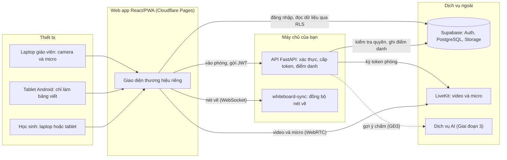
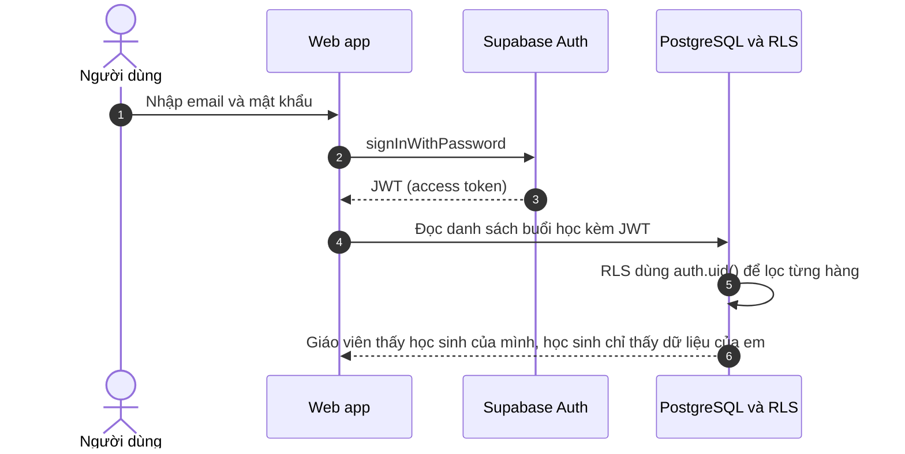
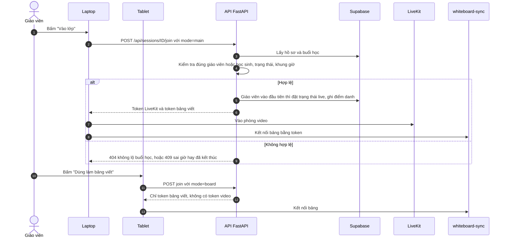
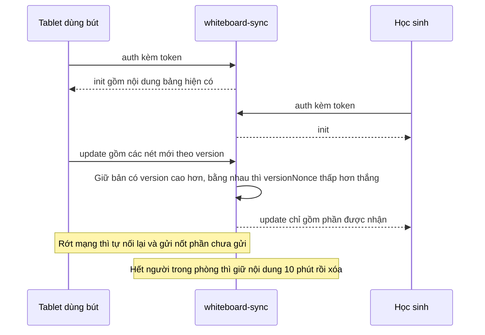
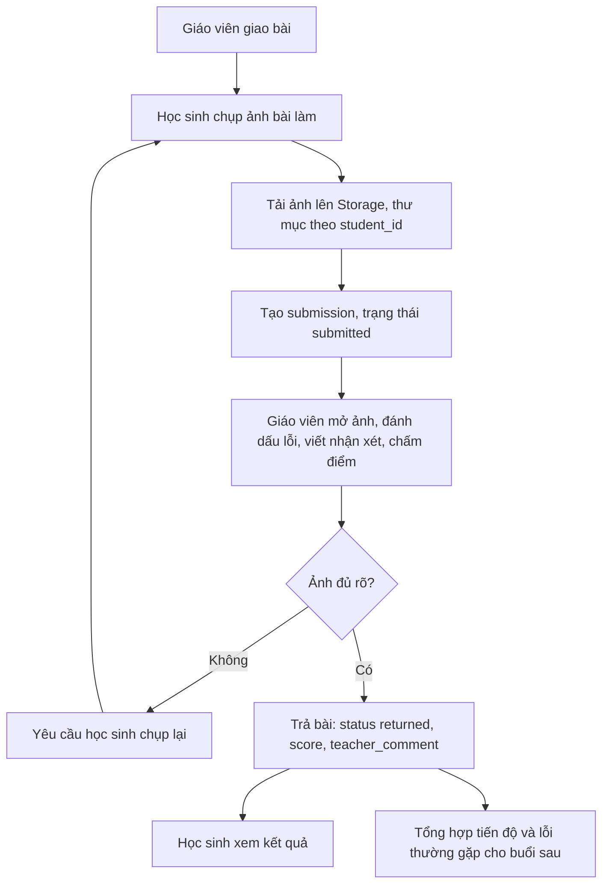
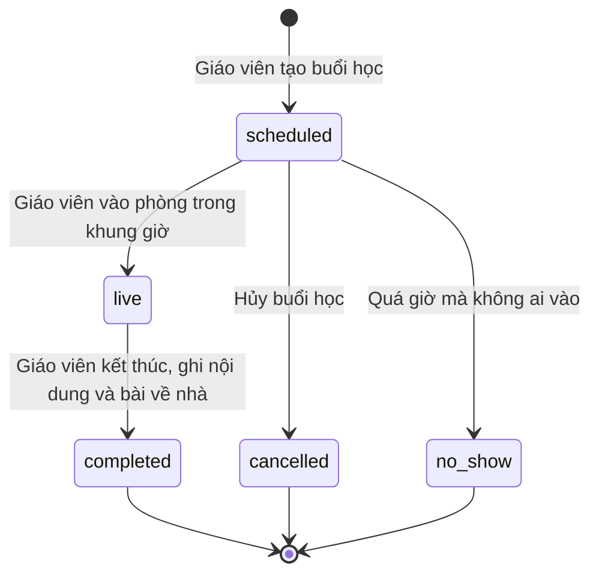
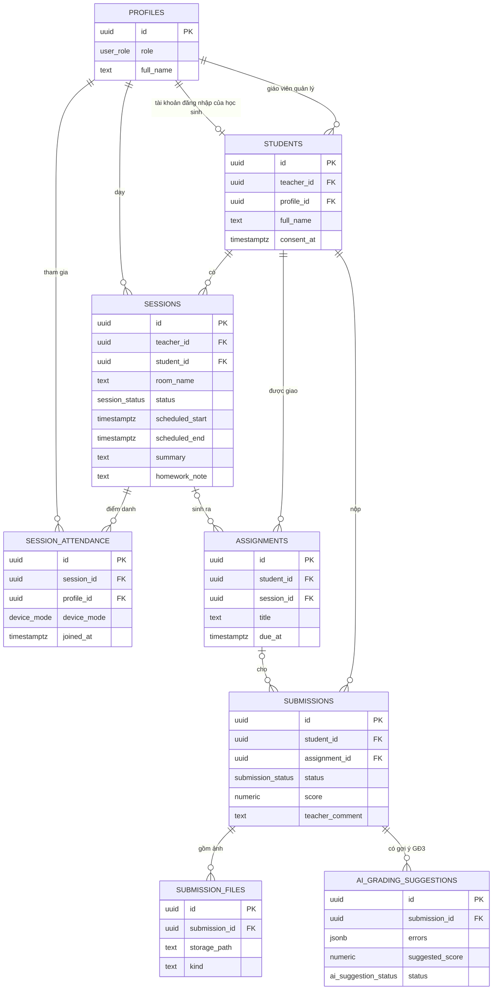
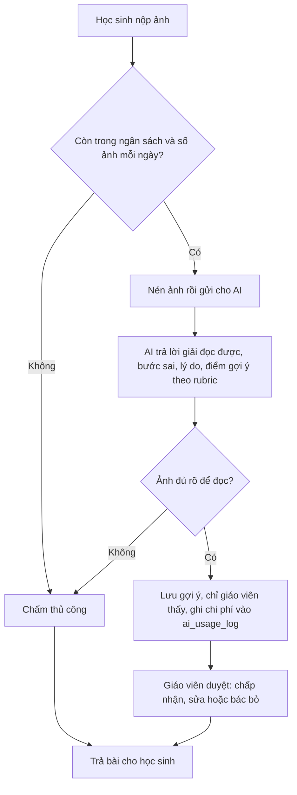
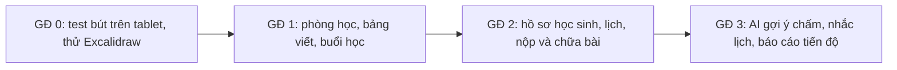

# Sơ đồ luồng

Các sơ đồ viết bằng Mermaid: GitHub, VS Code (có tiện ích Mermaid) và nhiều công cụ tự hiển thị. Sửa sơ đồ ngay trong file này.

Mỗi sơ đồ có phần **"Cần bạn xác nhận"** ở cuối trang này. Nếu luồng nào chưa đúng ý, sửa ở đây trước khi giao cho Claude Code/Codex code tiếp.

## 1. Kiến trúc tổng thể

## 2. Đăng nhập và phân quyền

## 3. Vào phòng học (laptop và tablet)

## 4. Đồng bộ bảng viết

## 5. Giao bài, nộp bài và chữa bài

## 6. Vòng đời một buổi học

## 7. Mô hình dữ liệu

## 8. AI gợi ý chấm (Giai đoạn 3, giáo viên luôn là người duyệt)

## 9. Lộ trình các giai đoạn

## Cần bạn xác nhận

1. **Học sinh có được viết lên bảng không?** Hiện tại có: cả hai bên cùng viết được. Nếu muốn học sinh chỉ xem, cần thêm quyền "chỉ xem" vào token bảng viết.
2. **Khung giờ vào phòng:** mặc định vào sớm 15 phút và muộn tối đa 60 phút sau giờ kết thúc (đổi ở `JOIN_EARLY_MINUTES`, `JOIN_LATE_MINUTES`).
3. **Học sinh vào trước giáo viên:** vẫn vào được phòng video nhưng buổi học chỉ chuyển sang `live` khi giáo viên vào.
4. **`no_show`:** sơ đồ 6 có trạng thái này nhưng chưa có tác vụ tự động đặt nó. Hiện chỉ đổi được thủ công.
5. **Tạo học sinh và buổi học:** chưa có màn hình trên web ở bản khung này, tạm thêm qua bảng điều khiển Supabase. Đây là việc đầu tiên của Giai đoạn 1.
6. **Ảnh bảng cuối buổi:** hiện tải về máy. Lưu tự động vào bucket `boards` và gắn vào buổi học là việc tiếp theo.
7. **Ghi hình:** tắt (`RECORDING_ENABLED=false`). Không có luồng ghi hình trong sơ đồ.
8. **Học sinh dưới 18 tuổi:** cột `consent_at` lưu thời điểm phụ huynh đồng ý. Chưa có ràng buộc chặn vào phòng nếu thiếu đồng ý, bạn có muốn bật không?
