# Sơ đồ luồng

Các sơ đồ viết bằng Mermaid: GitHub, VS Code (có tiện ích Mermaid) và nhiều công cụ tự hiển thị. Sửa sơ đồ ngay trong file này.

Quy trình mục tiêu mở rộng Teacher-Ops → bài tập → chấm có giáo viên duyệt → Tutor và đối chiếu với luồng đã có: [platform-workflow.md](platform-workflow.md). Các bước AI trong đó là lộ trình, chưa phải chức năng đang chạy.

Mỗi sơ đồ có phần **"Cần bạn xác nhận"** ở cuối trang này. Nếu luồng nào chưa đúng ý, sửa ở đây trước khi giao cho Claude Code/Codex code tiếp.

## 1. Kiến trúc tổng thể

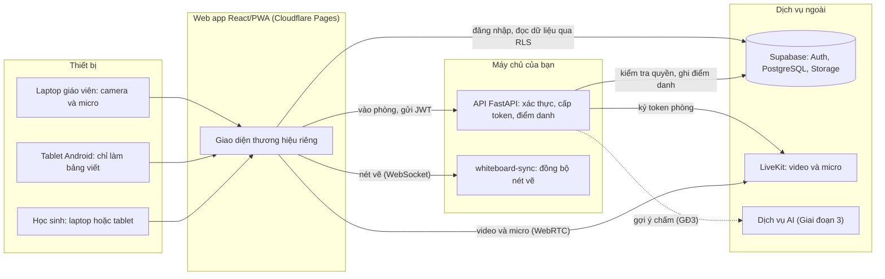

## 2. Đăng nhập và phân quyền

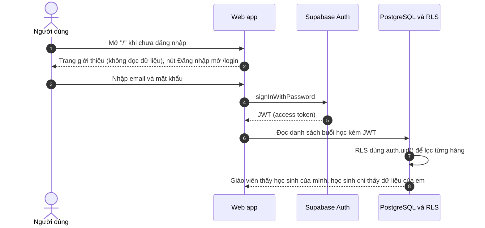

## 2b. Giáo viên tạo học sinh, tài khoản và buổi học

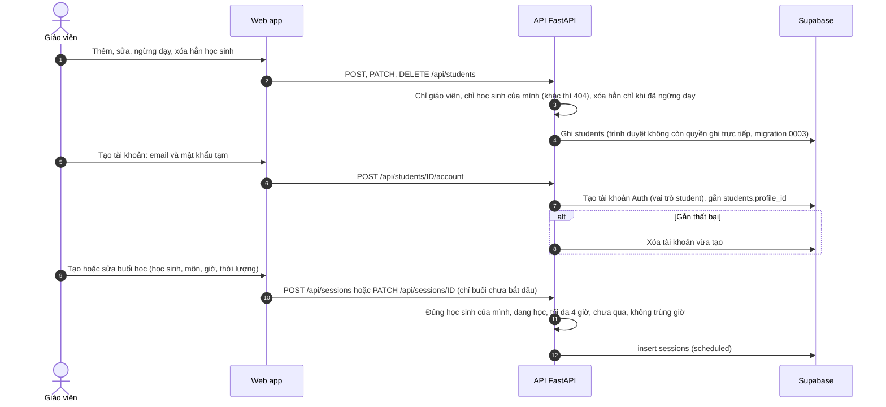

## 2c. Xóa hẳn học sinh (quyết định 19)

```mermaid
sequenceDiagram
  autonumber
  actor GV as Giáo viên
  participant W as Web app
  participant API as API FastAPI
  participant DB as Supabase
  participant WB as whiteboard-sync
  GV->>W: Xóa hẳn học sinh đã ngừng dạy (xác nhận)
  W->>API: DELETE /api/students/ID
  API->>DB: students.deleting_at (chỉ khi vẫn ngừng dạy): từ đây buổi học của em trả 404
  loop Mỗi buổi học của em
    API->>WB: POST /rooms/ID/purge: ngắt, xóa nội dung bảng, giữ dấu đóng (token cũ vẫn bị chặn)
  end
  API->>DB: Đọc board_upload_intents của em (sau khi đã ghi deleting_at)
  alt Còn lần lưu bảng đang chạy (hàng mới hơn 10 phút)
    API-->>W: 502 "bảng viết đang được lưu"; vòng lặp nền làm tiếp sau
  end
  API->>DB: Xóa tệp dưới STUDENT_ID/ trong bucket boards và submissions; hàng quá hạn chỉ ghi cleaned_at (không xóa)
  Note over API,DB: Vòng lặp nền canh hàng chưa được uploader xác nhận: xóa file nếu xuất hiện (ghi muộn), kể cả sau khi hồ sơ đã xóa
  alt Có bước lỗi
    API-->>W: 502 "Chưa xóa xong ...", hồ sơ còn (đang xóa) để thử lại
    Note over API,DB: Bấm "Xóa tiếp" hoặc vòng lặp nền của API làm tiếp
  else Đã dọn xong bảng và tệp
    API->>DB: Xóa buổi học (kéo theo điểm danh), rồi tài khoản Auth (kéo theo profiles), rồi hồ sơ học sinh (kéo theo bài tập, bài nộp)
    API-->>W: 204
  end
```

## 3. Vào phòng học (laptop và tablet)

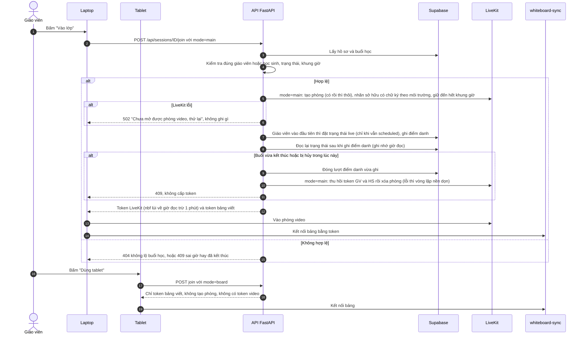

## 3b. Giáo viên kết thúc buổi học

```mermaid
sequenceDiagram
  autonumber
  actor GV as Giáo viên
  participant L as Laptop giáo viên
  participant API as API FastAPI
  participant DB as Supabase
  participant LK as LiveKit
  participant WB as whiteboard-sync
  participant X as Học sinh và tablet
  GV->>L: Kết thúc buổi học (nội dung, bài về nhà)
  L->>API: POST /api/sessions/ID/end
  API->>DB: status completed, ended_at, summary, homework_note, chỉ khi vẫn live (tính 1 buổi đã dạy)
  Note over API,DB: Đã completed (bấm lặp, mất phản hồi): không ghi lại, chỉ làm nốt các bước dưới
  API->>DB: session_attendance.left_at cho mọi lượt chưa rời
  API->>LK: Thu hồi token video của GV và HS (mốc = giờ hiện tại), rồi xóa phòng (thu hồi lỗi vẫn xóa, kết quả còn chờ)
  LK-->>X: Ngắt video (ROOM_DELETED)
  API->>WB: POST /rooms/ID/close với token đóng phòng
  WB-->>API: Nội dung bảng cuối (JSON)
  API->>DB: Ghi board_upload_intents, rồi kiểm tra học sinh không đang bị xóa (đang xóa thì bỏ qua)
  API->>DB: Lưu boards/STUDENT_ID/SESSION_ID.json, ghi board_snapshot_path, xóa hàng board_upload_intents
  WB-->>X: ended, đóng kết nối 4410, chặn token cũ vào lại (dấu đóng ghi xuống đĩa, còn sau khi máy chủ bảng khởi động lại)
  X->>X: Hiện "Buổi học đã kết thúc"
  API->>DB: Mọi bước trên xong thì ghi finalized_at
  API-->>L: 200, finalize_pending=true nếu còn bước lỗi (web hiện "Thử lại ngay")
  Note over API,WB: Mỗi bước chạy độc lập, lỗi bước này không chặn bước khác; API không cấp token mới cho buổi đã xong
  Note over API,DB: completed mà finalized_at rỗng: vòng lặp nền của API thử lại cả chuỗi (kể cả sau khi API khởi động lại)
  Note over API,LK: Vòng lặp nền dọn phòng của buổi đã đóng kể cả finalized_at đã ghi; phòng không còn buổi chỉ xóa khi nhãn sở hữu có chữ ký khớp môi trường/tên phòng. DB lỗi hoặc phòng lạ thì giữ lại
  Note over API,WB: Đóng bảng gọi lại được và trả lại bản cuối; lỗi đĩa trả 500 (vẫn ngắt, chặn), không báo đã lưu
```

## 4. Đồng bộ bảng viết

```mermaid
sequenceDiagram
  participant T as Tablet dùng bút
  participant WB as whiteboard-sync
  participant S as Học sinh
  T->>WB: auth kèm token
  WB-->>T: init gồm nội dung bảng hiện có
  S->>WB: auth kèm token
  WB-->>S: init
  T->>WB: update gồm các nét có phiên bản (version, versionNonce) khác bản máy chủ đã có, chia lô tối đa 500 phần tử và 1 MB
  WB->>WB: Giữ bản có version cao hơn, bằng nhau thì versionNonce thấp hơn thắng
  WB-->>S: update chỉ gồm phần được nhận
  S--xWB: update từ học sinh bị bỏ qua (học sinh chỉ xem bảng)
  loop Mỗi 5 giây, chỉ sau khi đã nhận init
    T->>WB: ping n
    WB-->>T: pong n (chỉ số thứ tự)
  end
  Note over T: Không có pong trong 10 giây (đường truyền treo, không có close): bỏ socket cũ, báo mất kết nối, nối lại theo backoff. Không có init trong 10 giây sau khi nối: thử lại
  Note over T: Quay lại tab/thiết bị thức mà pong mới nhất đã quá 10 giây: hiện "đang kiểm tra kết nối" và ping ngay
  loop Mỗi 15 giây, mọi kết nối (máy chủ tự kiểm đường truyền)
    WB->>S: ping khung điều khiển WebSocket
    S-->>WB: pong do trình duyệt tự trả lời (không cần timer JS, tab nền vẫn trả lời)
  end
  Note over WB: Một chu kỳ không có pong hay tin nào: terminate, gỡ khỏi phòng, gửi peers cho người còn lại (gỡ sau 15–30 giây). Phòng rỗng thì giữ và lưu như khi rời phòng
  Note over T,WB: Rớt mạng thì tự nối lại; init của máy chủ là mốc, máy viết gửi bù nét máy chủ chưa có
  Note over T: Ảnh không đồng bộ: bị gỡ khỏi bảng kèm thông báo. Phần tử một mình quá 1 MB: bỏ qua, không làm rớt kết nối
  Note over WB: Ghi data/boards/ID.json 2 giây sau nét cuối; mở lại phòng hoặc khởi động lại thì nạp lại
```

## 4b. Thử bảng viết cục bộ (chỉ development)

Trang `/dev/whiteboard` dùng đúng `Whiteboard` và giao thức ở mục 4; chỉ khác chỗ lấy token. Không có trong bản build production, không cần Supabase/API/LiveKit. Chế độ Wi-Fi (`make dev-board-lan`/`dev-web-lan`, tablet cùng mạng): thay `127.0.0.1` bằng IP LAN đã chọn cho web, cấp token và proxy (máy chủ bảng vẫn `127.0.0.1`), Origin chỉ `http://IP:cổng web`, và mọi lệnh tới cấp token phải kèm mã ghép nối.

```mermaid
sequenceDiagram
  participant G as Tab giáo viên (/dev/whiteboard)
  participant H as Tab học sinh (/dev/whiteboard)
  participant T as Cấp token thử 127.0.0.1:8789
  participant P as Proxy đường truyền 127.0.0.1:8790
  participant WB as whiteboard-sync thật 127.0.0.1:8788
  opt Chế độ Wi-Fi
    G->>T: GET /token (chưa có mã)
    T-->>G: 401: trang hỏi mã ghép nối in ở cửa sổ máy chủ thử, lưu trong sessionStorage của tab
  end
  G->>T: GET /token?role=teacher&room=dev-1&line=id tab[&pair=mã] (chỉ Origin của Vite)
  T-->>G: token ký bằng khóa ngẫu nhiên của lần chạy này, URL ws qua proxy kèm id tab
  H->>T: GET /token?role=student&room=dev-1&line=id tab
  G->>P: auth, update, ping (như mục 4)
  P->>WB: chuyển nguyên byte
  WB-->>H: update (qua proxy)
  H-->>G: BroadcastChannel: đã nhận (chỉ giữa các tab cùng trình duyệt, không qua máy chủ; tablet khác không báo về được)
  G->>T: POST /pause?room=dev-1&seconds=10 (nút "Ngắt máy chủ thử")
  T->>WB: cắt kết nối của phòng, ngừng nhận kết nối mới 10 giây
  G->>T: POST /hang?line=id tab&seconds=40 (nút "Treo đường truyền tab này")
  T->>P: giữ dữ liệu hai chiều của tab đó, không đóng kết nối; hết 40 giây thì chuyển nốt
  Note over G: Không có pong trong 10 giây: báo mất kết nối, thử nối lại (cũng treo) đến khi proxy thả
  Note over WB,H: Máy chủ không nhận pong khung điều khiển trong một chu kỳ 15 giây: gỡ kết nối của tab G, tab H thấy bớt một thiết bị
  Note over G,WB: Viết tiếp khi mất kết nối; nối lại thì gửi bù (init là mốc); phản hồi muộn của socket cũ bị bỏ qua
```

## 5. Giao bài, nộp bài và chữa bài

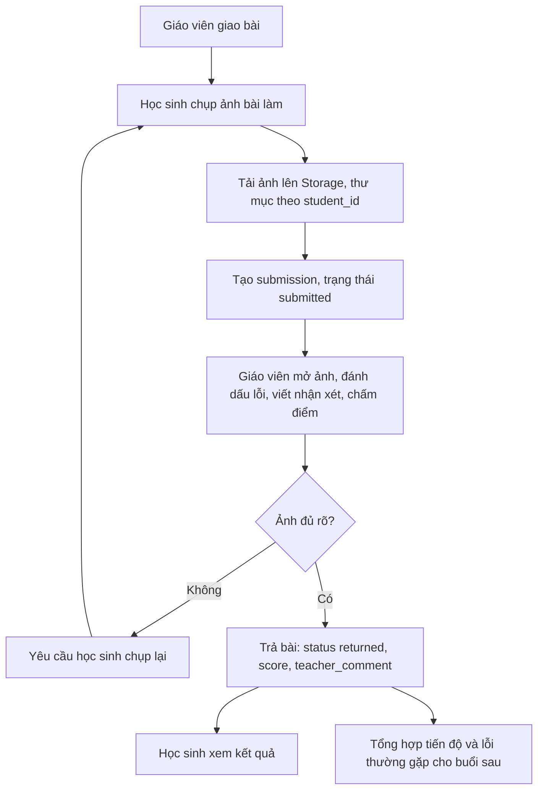

## 6. Vòng đời một buổi học

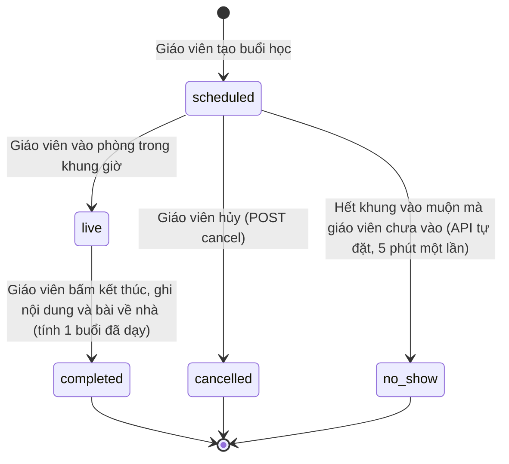

## 7. Mô hình dữ liệu

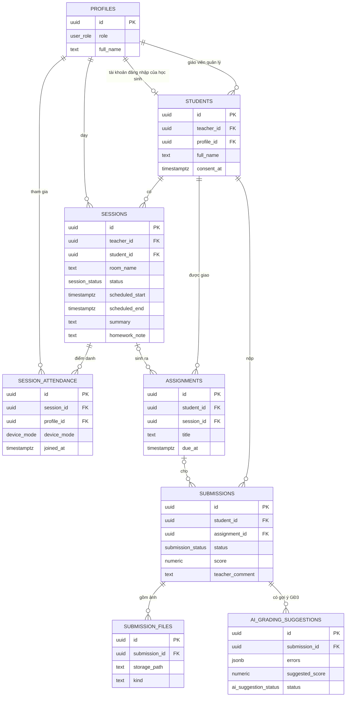

## 8. AI gợi ý chấm (Giai đoạn 3, giáo viên luôn là người duyệt)

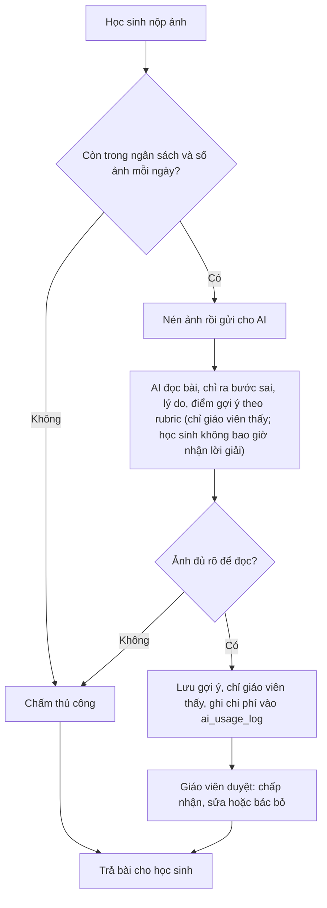

## 8b. Báo cáo tháng (lát M1a theo đặc tả Tutor)

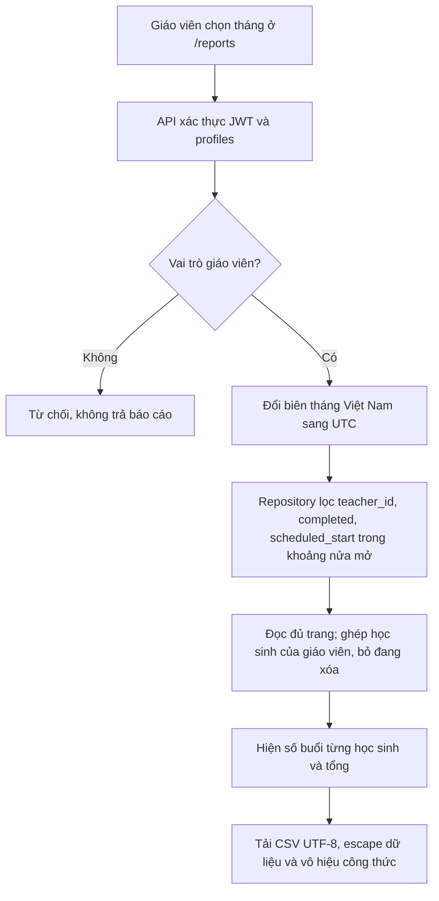

Giữ cách xác định completed hiện hành, gồm buổi còn chờ finalize; không suy ra điểm danh/video từ số buổi. Báo cáo chỉ đọc, không giữ lịch sử sau xóa hẳn, không chứa ghi chú hay thông tin phụ huynh. Ghi chú riêng/chủ đề có luồng 8c; lịch lặp và Teacher-Ops trong `platform-workflow.md` chưa triển khai.

## 8c. Ghi chú riêng sau buổi và chủ đề đã dạy (M1a.2)

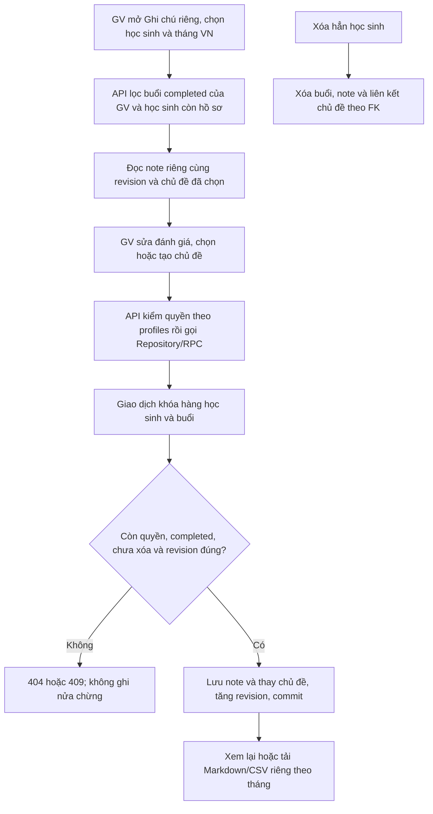

Học sinh và giáo viên khác không đọc được note qua API hoặc PostgREST/RLS. Ghi chú riêng không thay `summary`/`homework_note` ở lịch sử học sinh. Danh mục chủ đề thuộc GV; chỉ liên kết vào buổi completed mới biểu thị đã dạy. Chưa có Tutor hoặc truy xuất tài liệu. Khung giờ tháng luôn theo Việt Nam dù đổi ngôn ngữ hiển thị.

## 8d. Linh vật trợ giúp sử dụng ứng dụng

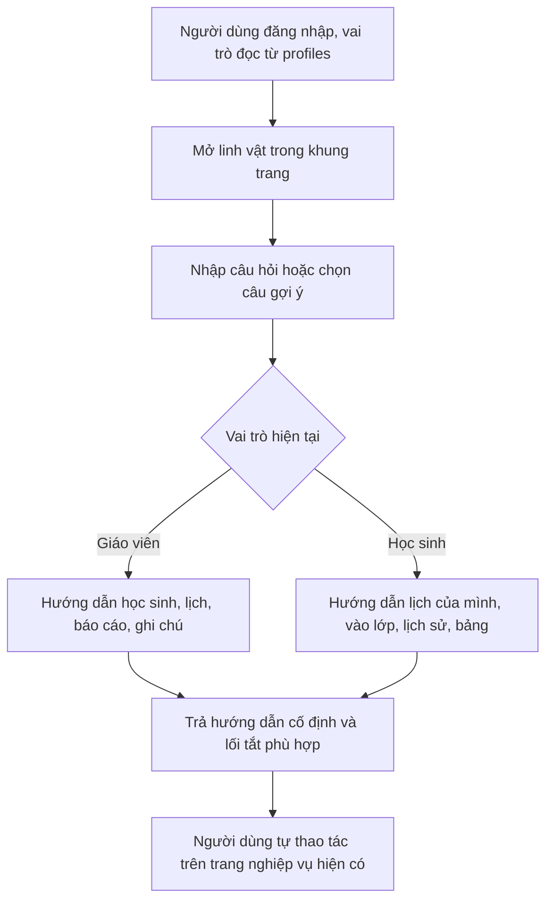

Luồng trên là chế độ Hướng dẫn cục bộ. Chế độ Hỏi AI đã có code, tắt mặc định. Hội thoại chỉ ở bộ nhớ component, không lưu vào localStorage/DB/log. Linh vật chỉ nằm trong AppShell, không che vùng bảng/phòng học.

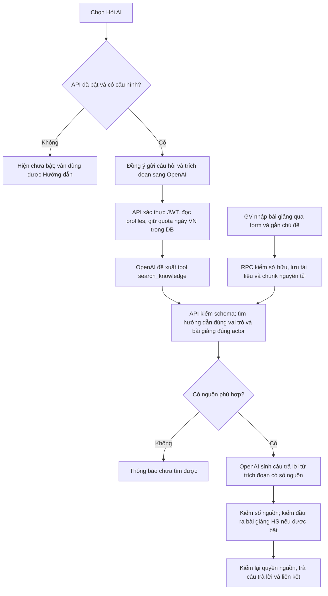

Học sinh chỉ có hướng dẫn ứng dụng khi cờ bài giảng HS tắt. Khi bật, bài giảng phải được công bố và thuộc chủ đề đã dạy trong buổi completed của đúng học sinh/GV. Chưa dùng embedding hoặc đọc PDF; chưa kiểm model thật E6/E7. Agent không có tool ghi nghiệp vụ; lỗi provider/guard/nguồn được chặn. Xem [assistant.md](assistant.md); chưa hoàn tất M1b/M4.

## 9. Lộ trình các giai đoạn

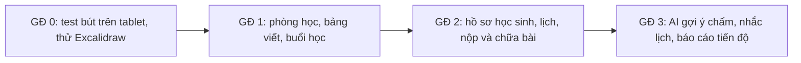

## Cần bạn xác nhận

1. **Học sinh có được viết lên bảng không?** Đã chốt: chỉ xem (quyết định 14).
2. **Khung giờ vào phòng:** mặc định vào sớm 15 phút và muộn tối đa 60 phút sau giờ kết thúc (đổi ở `JOIN_EARLY_MINUTES`, `JOIN_LATE_MINUTES`).
3. **Học sinh vào trước giáo viên:** vẫn vào được phòng video nhưng buổi học chỉ chuyển sang `live` khi giáo viên vào.
4. **`no_show`:** API tự đặt cho buổi còn `scheduled` sau giờ kết thúc + `JOIN_LATE_MINUTES`, tức giáo viên chưa vào (học sinh vào một mình vẫn tính là vắng). Buổi `live` chỉ thành `completed` khi giáo viên bấm kết thúc (quyết định 15).
5. **Tạo học sinh và buổi học:** đã có (sơ đồ 2b), gồm sửa và hủy buổi chưa bắt đầu. Mọi thao tác ghi chỉ giáo viên làm được, qua API (quyết định 12).
6. **Bảng cuối buổi:** tự lưu vào bucket `boards` khi giáo viên kết thúc, xem lại ở "Buổi đã học" (quyết định 17). Nút "Tải ảnh bảng" vẫn còn để tải PNG về máy.
7. **Ghi hình:** tắt (`RECORDING_ENABLED=false`). Không có luồng ghi hình trong sơ đồ.
8. **Học sinh dưới 18 tuổi:** cột `consent_at` lưu thời điểm phụ huynh đồng ý. Đã chốt (2026-10-19): không chặn vào phòng, chỉ ghi nhận và hiện cảnh báo trên trang học sinh.
