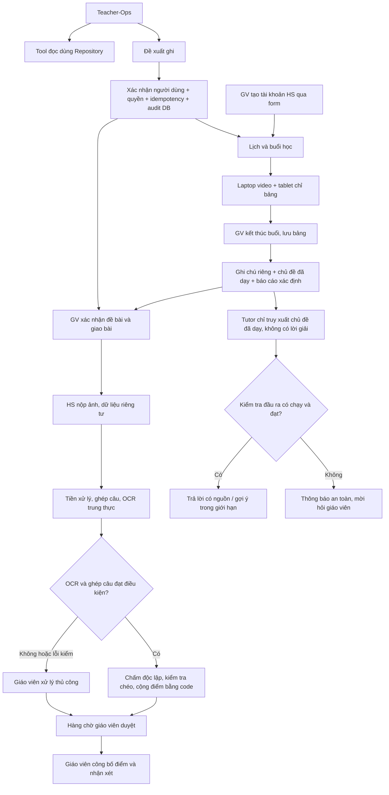

# Quy trình hợp nhất nền tảng lớp học và TUTOR_PLATFORM_SPEC

Ngày đối chiếu: 2026-10-20. Đặc tả nguồn: [TUTOR_PLATFORM_SPEC.md](../TUTOR_PLATFORM_SPEC.md), v0.1. Đây là đánh giá và kế hoạch nối vào repo hiện có; không coi mục tiêu/ngưỡng nháp là kết quả đã đạt.

## Kết luận khả thi

Khả thi theo từng lát có thể chạy trọn luồng: dữ liệu/quyền xác định trước, Teacher-Ops sau đó; bài tập và giáo viên duyệt trước khi tự động hóa OCR/chấm; Tutor có giới hạn chủ đề sau khi có tài liệu. Không có cơ sở để cam kết độ chính xác OCR/chấm, không rò rỉ đáp án, chi phí hoặc thời gian đáp ứng trước khi có baseline phù hợp.

| Phần | Đánh giá | Điều kiện triển khai |
|---|---|---|
| Lịch, tài khoản, buổi, đếm buổi, ghi chú | Khả thi; phần lớn đã có nền | Làm rõ tiêu chí đếm buổi, bổ sung ghi chú riêng đúng RLS |
| Teacher-Ops | Khả thi với tool xác định và thẻ xác nhận | Quyền từ phiên; pending action/idempotency/audit phải bền trong DB trước khi cho ghi |
| Nộp nhiều ảnh, ghép nhiều câu | Khả thi theo từng bước | Upload riêng tư, kiểm MIME/giới hạn, bỏ EXIF, giáo viên sửa ghép câu |
| Sinh đáp án và chấm tự động | Cần thử nghiệm | Hai model đồng ý không chứng minh đúng; luôn duyệt trước công bố; OCR kém dừng |
| Tutor theo chủ đề, không cho lời giải | Khả thi ở dạng có giới hạn; chưa thể bảo đảm tuyệt đối | Lọc tài liệu tại truy vấn, cách ly lời giải, chặn đầu ra khi bộ kiểm tra lỗi; eval đối kháng |
| Queue Postgres và nhiều worker | Phù hợp quy mô đề xuất | Lease, retry, idempotency, khôi phục worker chết; không giữ job/pending trong RAM |
| Linh vật/email | Khả thi, ưu tiên cuối | Placeholder; email tắt mặc định; không cản luồng học |

Đã đối chiếu [Structured Outputs OpenAI](https://developers.openai.com/api/docs/guides/structured-outputs) và [Gemini structured output](https://ai.google.dev/gemini-api/docs/structured-output): schema giúp kiểm cấu trúc đầu ra, không thay kiểm nghiệp vụ/độ đúng. Hai bài [HITL handwritten math](https://arxiv.org/abs/2603.13083) và [large-scale handwritten benchmark](https://arxiv.org/abs/2603.00895) đã kiểm trang thông tin/tóm tắt; chưa tái lập nghiên cứu hoặc kiểm toàn văn. Không dùng số liệu/giấy phép nguồn tham khảo chưa kiểm làm cổng sản phẩm; chưa sao chép mã repo bên ngoài.

## Các điểm cần thống nhất trước khi thay luồng hiện hành

| Mục trong spec | Dự án hiện tại | Phương án tích hợp |
|---|---|---|
| Repo backend/web, SQLAlchemy/Alembic/uv | apps/api, apps/web, Supabase migrations, Repository, npm | Giữ cấu trúc/stack, ánh xạ chức năng vào các module mới; không dựng repo thứ hai |
| Tự làm auth argon2/cookie/CSRF | Supabase Auth/JWT và profiles | Giữ auth hiện có. Mật khẩu không qua chat; tool nhận principal từ API, không từ model. CSRF áp theo cơ chế auth thực tế, không bê nguyên checklist cookie |
| Xóa mềm mọi dữ liệu | Ngừng dạy và xóa hẳn có retry, dọn Auth/Storage | Không lặng lẽ đổi xóa hẳn thành lưu vô hạn. Lưu trữ/ngừng dùng khác với quyền xóa dữ liệu; các bảng AI mới phải nối vào quy trình xóa |
| Chỉ tính buổi hai bên đã vào + GV xác nhận | completed do GV bấm kết thúc; lượt join chưa chứng minh media thật | Cần chốt “đã vào” là API attendance hay kết nối thực; chưa đổi cách đếm hiện hành. Bổ sung trước báo cáo so sánh, không viết lại lịch sử ngầm |
| Ghi chú chỉ GV xem | summary/homework hiện có thể xuất hiện ở history của HS | Thêm bảng ghi chú riêng/RLS; không biến trường đang công khai thành ghi chú riêng |
| M0 khởi tạo lại, /healthz, DTZ | API health, CI, Docker, web/board đã có | Tái dùng; bổ sung clock guard/E0, tránh làm lại ứng dụng |
| STATUS và thay CLAUDE/AGENTS | docs/progress là nguồn bàn giao, CLAUDE=@AGENTS | STATUS chỉ là nhật ký mốc có liên kết; không tạo hai backlog hoặc ghi đè hướng dẫn đang dùng |
| Không giữ trạng thái trong tiến trình | Board realtime có room trong RAM + file bền | Áp tính bền cho queue/pending/rate limit mới; không giả định đổi board sang serverless mà không thiết kế riêng |
| Dừng xin duyệt trước mọi mốc | Chủ dự án muốn làm liên tục | Sau khi chốt hướng tích hợp, tự làm các lát đã duyệt; chỉ gom quyết định kiến trúc/nghiệp vụ/dịch vụ thật chưa có quyền |
| Migration rollback | Migration đã áp không sửa, dữ liệu HS cần bảo vệ | Migration mới có RLS/test; tài liệu phục hồi, không tự rollback production hay DROP dữ liệu |

Chủ dự án đã chọn **giữ nền tảng hiện tại, tích hợp spec theo từng mốc** (quyết định 22). Giữ Supabase Auth, Repository, cấu trúc repo và npm; triển khai liên tục từng lát cục bộ. Những thay đổi về xóa dữ liệu, điều kiện completed và gọi dịch vụ thật vẫn phải được chốt riêng trước khi áp dụng.

## Một chuỗi nghiệp vụ thống nhất

Sơ đồ là quy trình mục tiêu: A–D có code, phần dịch vụ thật còn chờ nghiệm thu; E đã có báo cáo tháng và ghi chú riêng/chủ đề cục bộ (ghi chú cần migration 0008); F trở đi chưa chạy. Teacher-Ops dùng cùng nghiệp vụ/API với form, không có đường ghi riêng để né kiểm tra. Mọi ranh giới trả lỗi phải có thông báo tiếng Việt và đường thử lại/chuyển người.

## Mốc triển khai và cổng

| Mốc | Lát thực hiện trên repo này | Bằng chứng cần có | Trạng thái |
|---|---|---|---|
| GĐ1 hiện hữu | Không làm lại phòng học; giữ B2/test hiện có | acceptance + tablet + dịch vụ thật theo quyền | Code hiện có, chưa nghiệm thu toàn bộ |
| M0 tích hợp | Clock chung, DTZ/AST guard, E0 JSONL/runner/report, CI, sổ mốc | Test time/guard/runner; lệnh CI cục bộ; không báo E1–E9 đạt | Phần nền cục bộ đạt: 186 API, E0 thời gian 10/10; chưa xác nhận CI GitHub hoặc toàn mốc M0 bản spec |
| M1a quản lý | Báo cáo tháng VN, chủ đề, ghi chú riêng/xuất, lịch lặp có khóa chống sinh trùng | API → DB/RLS → web → test người được/không được phép | Đã code/test báo cáo tháng + CSV, ghi chú riêng/chủ đề/xuất (0008) và lịch hằng tuần (0009, chưa áp lên Supabase). Giữ completed/xóa hiện hành |
| M1b Teacher-Ops | Tool registry Pydantic, quyền theo profiles, pending/confirm/audit/idempotency DB; agent chỉ gọi cùng dịch vụ | E1 bộ câu rõ/mơ hồ; E2 nâng quyền/IDOR/replay; xác nhận hết hạn hoặc dữ liệu đổi không ghi ngầm | Chưa làm |
| M2 bài tập | Dùng/mở rộng assignments/submissions hiện có bằng migration mới; đề xác nhận; nhiều ảnh; reference_solution cách ly; job bền | RLS không đọc chéo, không đọc lời giải; test upload/câu thiếu/nộp lại; E5 baseline | Chưa làm |
| M3 chấm bài | Gateway cấu hình provider/model/prompt; worker từng bước; confidence/calibration; review/release | E3/E4/E8 + dữ liệu nhãn tay; không công bố điểm trước duyệt; retry/cost cap | Chưa làm; không có dữ liệu để chốt độ chính xác |
| M4 Tutor | Chủ đề đã dạy → tài liệu không phải lời giải → gợi ý → kiểm đầu ra → chat disclosure/retention | E6/E7, lỗi guard fail-closed, transcript thuộc HS, không coi 0 lỗi mẫu là bảo đảm tuyệt đối | Chưa làm |
| M5 vận hành | UI hoàn thiện, linh vật placeholder, email tắt, backup/restore, nhà cung cấp/triển khai đã chọn | E9 toàn luồng thật + chi phí đo + restore đã thử | Chưa làm |

Mỗi lát gồm model/quyền → Repository + FakeRepo → migration mới nếu cần → API → UI → test → cập nhật progress. Không chuyển sang chấm AI thật khi mới có khung mô phỏng; cổng thiếu dữ liệu ghi `chưa đo`/`not_run`, không đánh dấu đạt.

### M1a.1 — Báo cáo số buổi theo tháng

- Giáo viên mở `/reports`, chọn tháng, xem từng học sinh và tải CSV UTF-8. API `GET /api/reports/sessions?month=YYYY-MM`; bỏ tháng thì lấy tháng hiện tại ở Việt Nam. Quyền đọc từ `profiles`, lọc teacher_id ở Repository; học sinh không được đọc báo cáo tổng hợp.
- Chỉ đếm `status=completed`, theo `scheduled_start` trong `[00:00 đầu tháng, 00:00 đầu tháng sau)` ở UTC+7. Không thêm điều kiện điểm danh/finalized_at. Tháng cắt qua UTC, giờ sát biên, hủy/live, sai giáo viên và phân trang PostgREST có test xác định.
- Có học sinh ngừng dạy và học sinh chưa có buổi (số 0); bỏ học sinh đang xóa. Xóa hẳn vẫn xóa lịch sử: báo cáo không giữ sổ tính tiền hay số liệu sau xóa. Không xuất ghi chú, thông tin phụ huynh hoặc token. CSV escape dấu nháy/xuống dòng và vô hiệu ký tự mở đầu công thức.
- Không thêm bảng/migration/thư viện ở lát báo cáo. Đây là lát đọc dữ liệu hiện hành; chưa phải toàn bộ M1 hoặc Teacher-Ops.

### M1a.2 — Ghi chú riêng và chủ đề đã dạy

- Trang `/teaching-notes` dành cho giáo viên: chọn học sinh (kể cả đã ngừng dạy) và tháng VN, xem buổi completed, sửa nhận xét/mức độ nắm bài/cần cải thiện/bài tập riêng, gắn tối đa 50 chủ đề; tải Markdown hoặc CSV. Có lối vào từ Buổi đã học. Nội dung ghi chú hiển thị như văn bản, không chạy HTML/Markdown nhập vào.
- Migration `0008_private_teaching_notes.sql`: `session_notes` riêng với revision; `teaching_topics` là danh mục thuộc giáo viên, tên/lớp trùng chính xác thì dùng lại; `session_topics` liên kết buổi–chủ đề. Chủ đề chọn ở đây là xác nhận đã dạy; `sessions.topic` hiện hữu vẫn chỉ là nội dung dự kiến, không tự chuyển thành quyền Tutor.
- RPC `save_teaching_record` chỉ service_role được gọi. Giao dịch khóa học sinh/buổi, kiểm profiles/quyền/completed/deleting_at và expected_revision, rồi lưu note + thay liên kết chủ đề cùng lúc. Hai tab dùng phiên bản cũ nhận 409, giữ bản nháp để người dùng tải lại/xử lý. Không dùng khóa trong RAM.
- RLS cho phép chỉ giáo viên sở hữu đọc danh mục/note/liên kết; học sinh không thấy cả ghi chú buổi của chính mình. Mọi ghi đi qua API/Repository. Xóa buổi/học sinh kéo theo note và liên kết; danh mục chủ đề độc lập còn lại, không tự giữ nội dung đánh giá sau xóa. Không đổi summary/homework_note đang hiển thị cho học sinh hoặc điều kiện completed.
- Preflight kiểm cả 3 bảng mới; `verify_migrations.sql` nay có 14 mục. Rollback thủ công ở `supabase/rollback/0008_private_teaching_notes.sql` chỉ cho bảng trống và gỡ code tương ứng trước; có dữ liệu thì từ chối DROP. Không tự áp/gỡ schema trên dịch vụ thật.
- Test: API/quyền/đếm tháng/phân trang và RPC adapter, RLS người được/không được phép, hai kết nối thật kiểm CAS và lưu trong lúc xóa, rollback có/không dữ liệu, CSV/Markdown an toàn, Chromium lưu/xung đột/xuất/chặn HS và đổi ngôn ngữ. Kết quả thực chạy trong progress. Bước tiếp theo: lịch lặp có ràng buộc chống sinh buổi trùng, rồi Teacher-Ops.

### M1a.3 — Lịch hằng tuần

- Giáo viên mở "Lịch hằng tuần" ở từng học sinh đang học: chọn thứ, giờ (giờ Việt Nam), thời lượng 30–240 phút, môn. API `GET/POST /api/weekly-slots`, `PATCH /api/weekly-slots/{id}` với `{active:false}` để ngừng. Không sửa giờ của lịch: ngừng lịch cũ, tạo lịch mới.
- Migration `0009_weekly_slots.sql`: bảng `weekly_slots` (RLS chỉ GV sở hữu đọc, chỉ API ghi); `sessions.slot_id`, `slot_date` với unique `(slot_id, slot_date)`. Chống sinh trùng nằm ở DB, không ở RAM: nhiều tiến trình/vòng lặp cùng sinh vẫn một buổi mỗi ngày của lịch; buổi đã hủy hoặc dời giờ giữ khóa đó nên không bị sinh lại.
- Sinh trước 28 ngày khi tạo lịch, vòng lặp nền bổ sung mỗi chu kỳ. Ngày trùng giờ với buổi scheduled/live khác thì bỏ qua và báo lại, không ghi đè. Buổi đã bắt đầu không sinh. Học sinh ngừng dạy, đang xóa hoặc khác giáo viên: không sinh. Xóa hẳn học sinh xóa dây chuyền lịch và buổi.
- Ngừng lịch (mặc định của Claude, chủ dự án có thể đổi): không sinh thêm, các buổi scheduled tương lai của lịch chuyển `cancelled` (vẫn hiện trong lịch sử dạng đã hủy); buổi đã học, đang diễn ra và buổi xếp tay giữ nguyên. Lần sinh xen đúng lúc ngừng được vòng lặp nền hủy lại ở chu kỳ sau.
- Giới hạn: trùng giờ vẫn là kiểm tra rồi ghi (như tạo buổi tay); cần chặn tuyệt đối thì thêm exclusion constraint. Chưa có lịch hai tuần một lần, ngày nghỉ lễ, đổi giờ hàng loạt. Rollback `supabase/rollback/0009_weekly_slots.sql` chỉ khi chưa có lịch.

## Mặc định OQ để tránh hỏi lặp

Giữ mặc định trong spec cho các chức năng **mới**: OQ1 gắn nhãn ảnh tùy chọn; OQ2 bất đồng chuyển GV; OQ3 ảnh/PDF/LaTeX nhưng xác nhận đề; OQ5 email tắt; OQ6 HS chỉ thấy điểm/nhận xét; OQ7 ba lượt cấu hình được; OQ8 chưa có dữ liệu nhãn tay thì chỉ baseline; OQ9 placeholder; OQ10 lớp 7/9; OQ11 ba lần nộp, giữ lịch sử theo chính sách xóa đã chốt. OQ4 giữ container trung lập, chưa chọn/mua Cloud Run hay đổi hosting. Không coi “mặc định” là quyền gửi dữ liệu HS cho nhà cung cấp.

## Test và điều kiện bắt đầu gọi AI

Theo yêu cầu riêng ngày 2026-10-21, đã code/test lát **bot OpenAI chỉ đọc + RAG văn bản**: tool tìm hướng dẫn/bài giảng đúng quyền, nguồn trích dẫn, quota DB và biểu mẫu quản lý bài giảng. Đây là phần nền riêng, chưa hoàn thành M1b/M4. Tính năng tắt mặc định; bài giảng cho HS có cờ tắt riêng chờ E6/E7. Cách bật, migration 0010, dữ liệu gửi provider và giới hạn: [assistant.md](assistant.md). Chưa gọi model thật; E1/E6/E7 vẫn `not_run`.

- Giữ [testing-plan.md](testing-plan.md) và test API/board/RLS/E2E đang được Claude bổ sung; eval mới ở [evals](../evals/README.md) kiểm đúng phiên bản code, không thay test dịch vụ.
- E0 đã có phần thời gian; E1–E9 chưa có runner toàn mốc. Giữ tập dev/test tách nhau. Ngưỡng 95%, 90%, 2–5% là mục tiêu nháp cần dữ liệu, không phải cam kết.
- Trước gọi Gemini/OpenAI: quyền dùng provider/model, ngân sách, chính sách dữ liệu/retention và secret qua cấu hình được cấp riêng; không đọc/in `.env`. Gateway không log nội dung/PII, xử lý refusal/truncation/timeout như thất bại có kiểm soát.
- Cơ chế mật khẩu/CSRF/quyền hiện tại vẫn ở API, không ở prompt. Thông báo lưu chat cho HS cần có trước khi bắt đầu ghi chat thật; chat/ảnh/embedding/log và dữ liệu nhà cung cấp phải có quy trình xóa phù hợp.
- Mỗi job có lease và khóa bền; thao tác ngoài DB có thể hoàn tất muộn, cần canh dọn giống upload intent/B2 hiện tại, không chỉ dựa vào timeout phía client.
- Không sao chép mã ngoài repo khi chưa kiểm giấy phép. Phần pháp lý/điều khoản, giới hạn hosting và chi phí chưa được đánh giá trong phiên này; không dựa vào số liệu tham khảo để deploy.
